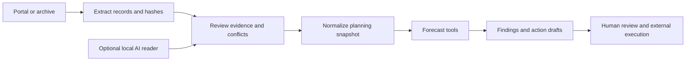

# LaunchGuard

**Evidence-based procurement planning for a fixed launch deadline.**

Built by **Hackenheimer** for Lio's *Keep the Line Running* challenge, LaunchGuard helps Soony determine what can be packed before dispatch, which materials or approvals put that plan at risk, and who needs to act next.

The application combines a packing forecast, reviewed evidence and a persistent queue of follow-up drafts. It runs locally with Node.js and has no application package dependencies.

> **Status:** the local application and authenticated portal sync work. A private hosted adaptation has been prepared but is **not deployed**; uploading the reviewed customer snapshot is awaiting approval. The optional local AI reader has not been validated with a configured model.

## Problem statement

Soony needs 640,000 Standard and 72,000 Collector's Editions ready for dispatch from Hamburg on **22 November 2026 at 20:00 CET**. At kickoff, 512,000 Standard and 46,800 Collector copies are packed, leaving **128,000 Standard and 25,200 Collector copies**.

Purchase orders alone cannot prove launch readiness. Stock counts, delivery notes, supplier confirmations, artwork revisions, inspection results and packing capacity may disagree. A delivery before truck departure can still arrive too late to pack.

LaunchGuard answers:

1. What can finish under the available evidence and working hours?
2. Which material, timing or release assumptions could invalidate that forecast?
3. What evidence request or escalation should the team prepare next?

## Solution and methodology

### 1. Acquire and preserve evidence

Use the customer archive or authenticated Soony portal. The sync script compares paths and SHA-256 hashes, downloads only new or changed files, and verifies size and checksum before replacement. Original records stay separate from normalized planning data.

### 2. Extract and normalize messy records

The Python extractor reads CSV, Excel, text-bearing PDFs and text documents. It inventories scans and image-only PDFs for review. The normalizer handles both the legacy semicolon-separated PO export and newer CSV format, including supplier IDs, line numbering and legacy decimal separators.

Extraction does not establish that a document is correct. Excel reads use saved cell values rather than recalculating the workbook. Full automatic OCR is not implemented.

### 3. Review conflicts explicitly

Private review annotations record stock corrections, conservative holds, embedded components, findings, assumptions and source references. The workflow supports distinctions such as ordered versus shipped quantities, a corrected receipt, an unreleased quality lot, or a component already fitted inside an assembly.

These decisions are inputs rather than quantities hidden in the forecast code. Their `sourceChecksums` must match the extracted archive before normalization proceeds. Changed evidence requires renewed review; copying new hashes alone is not a review.

### 4. Build a planning snapshot

Combine demand, packed totals, BOM quantities, aggregate line rates, shift windows and planning-usable component balances. Keep ERP balances separate from reviewed balances and preserve the original BOM in the extracted records.

The supplied customer analysis is an explicitly dated **kickoff replay**, not a live warehouse count. Its clock does not advance automatically. Allocation priorities and unresolved release assumptions remain visible for operational confirmation.

### 5. Simulate packing before dispatch

```text
Remaining demand = target - already packed
Material capacity = minimum floor(available component / BOM quantity)
Packing capacity = interval working hours × edition's aggregate hourly rate
Additional copies = minimum(remaining demand, material capacity, packing capacity)
```

The engine evaluates intervals at shift boundaries and usable shipment arrival times. It respects overnight closure, consumes shared components once and allocates them by declared product priority. It preserves fractional production capacity where applicable and never rounds up finished copies.

Only confirmed, released inbound with fresh tracking is admitted. Received lots are not added to stock twice. An overdue ETA without a receipt is not silently treated as delivered. ETA must mean **usable at the packing line after receiving and QA**, rather than arrival at a port or airport.

The customer baseline excludes inbound without that usable timestamp. Hypothetical material scenarios are labeled separately from executable timed plans. Overlapping component shortages must not be added together to count missing finished editions.

### 6. Write and review the next actions

The planner writes source-linked evidence requests and owner-assigned internal escalations. Stable identifiers prevent duplicate drafts on reruns; changed findings can produce new drafts. Queue state, review decisions and recent audit events persist locally.

**Drafting is the external-action preparation implemented here.** The app does not email suppliers, place orders, approve concessions, update SAP or commit spend. Marking a draft reviewed does not prove that its issue is resolved.

### 7. Keep AI proposals separate from calculations

An optional local Ollama reader proposes English claims, original quotes, uncertainties and a follow-up from multilingual supplier text. Exact quotes must appear in the source text. Returned proposals still need review before becoming planning inputs; quote grounding does not prove an interpretation is correct.

The forecast and action planner are deterministic tools. Without a configured model, this is a planning and evidence-review prototype, not an autonomous LLM procurement system.

## Features

| Feature | Function |
| --- | --- |
| Edition forecasts | Projected finished copies, gaps, working hours and required hourly rates |
| Evidence findings | Stock disagreements, release concerns, stale evidence and reviewed customer-specific risks |
| Action queue | Persistent, deduplicated drafts with owners and source references |
| Human review | Mark drafts reviewed/dismissed and inspect recent audit events |
| Snapshot import/export | Assess reviewed JSON data and export snapshots or actions |
| Recovery demo | Clearly labeled synthetic scenario showing how arrival timing affects feasibility |
| Customer pipeline | Extraction, normalization, material audit and conditional scenario outputs |
| Portal sync | Bearer authentication, hash comparisons, verified downloads and review warnings |
| Optional local AI | Multilingual text reading with verbatim-quote checks |

## Requirements and quick start

- **Node.js 22 or later** for the app and tests.
- A modern browser.
- **Python 3.10 or later**, `pypdf` and `openpyxl` only for customer-data extraction/refresh.
- PowerShell for the supplied Windows launcher and sync command.
- Ollama and an installed model only for optional AI reading.

From the repository root:

```powershell
node .\launchguard\server.mjs
```

Open **http://127.0.0.1:8787**. Keep PowerShell running while using the app; press **Ctrl+C** to stop it. No `npm install` or frontend build is required.

Alternatively, on Windows:

```powershell
.\RUN_LAUNCHGUARD.ps1
```

The launcher uses Node from PATH or an existing bundled Codex runtime. A fresh clone can run the synthetic sample without customer records.

## How to use the application

1. **Check the dataset banner.** Distinguish the synthetic sample from the reviewed customer archive replay.
2. **Inspect the forecast and findings.** Read sources and assumptions before making a decision.
3. **Click Run procurement agent.** The planner writes evidence requests and escalation drafts.
4. **Review the queue.** Check each owner, supporting source and requested evidence; mark drafts reviewed or dismissed.
5. **Export actions** for the team's registered supplier communication workflow. Sending happens outside this app.
6. **Import an updated snapshot** after reviewing new evidence. Imports replace the working snapshot and clear its action queue; export the old queue first if you need a copy.

The app restores saved working state when available and can load the local customer snapshot. After regenerating customer data, choose **Load Soony archive** to load it explicitly.

### Synthetic recovery walkthrough

Select **Load synthetic sample**, run the agent, and inspect the sample stock discrepancy and Collector shortfall. Run again to see deduplication. Select **Simulate sample delivery** and rerun: the earlier, confirmed and released arrival improves feasibility, while unresolved evidence remains visible. Download the snapshot, change the arrival time, import it, and compare forecasts.

The sample's supplier events, BOM assumptions and rates are test inputs, not findings about Soony. Restore the private snapshot using **Load Soony archive** when it is available.

## Customer-data setup and refresh

Customer records and review annotations are excluded from Git. A clone does not reproduce the private analysis by itself.

```text
customer-data/soony-data/             Original records: soony/ and suppliers/
launchguard/customer-data/
  extracted.json                     Extracted records and source hashes
  reviewed-evidence.json             Reviewed decisions and matching hashes
  snapshot.json                      Normalized planning input
  material-audit.json                Demand versus ERP/planning balances
  assessment.json                    Forecast and hypothetical scenarios
  action-drafts.json / .txt           Generated drafts; not sent messages
  launch-recovery-report.txt         Private written findings, when supplied
```

Extract the provided ZIP into `customer-data/`, preserving its `soony-data/` directory, or use the portal:

```powershell
.\SYNC_SOONY.ps1
```

Enter the API token at the hidden prompt. To compare hashes without downloading customer files:

```powershell
.\SYNC_SOONY.ps1 -CheckOnly
```

The token is used in memory as an `Authorization: Bearer` header and is not saved. A process-scoped `SOONY_API_TOKEN` environment variable is also supported. Never put actual credentials in source files or Git commits.

Removed portal files are retained for audit and excluded from later extraction when the saved portal index is available. The sync command compares portal hashes to the analysis baseline, so rerunning sync does not clear an outdated-analysis warning. Failed syncs also leave a review warning. No automatic polling is scheduled.

Install the extraction libraries if needed:

```powershell
python -m pip install pypdf openpyxl
```

Then, from the repository root:

```powershell
python .\launchguard\extract_customer_data.py
# Review changed evidence and update the private reviewed-evidence.json.
python .\launchguard\normalize_customer_data.py
node .\launchguard\analyze_customer.mjs
```

**The review step is required.** The normalizer expects `evaluationTime`, `stockAdjustments`, `conservativeHolds`, `embeddedComponents`, `findings`, `assumptions` and `sourceChecksums` in the private review file. Obtain that file through the team's authorized data-sharing process, or create it from an evidence review. The checksum map must cover every extracted source path and its reviewed SHA-256; adjustment arrays may be empty where no adjustments apply.

See the [implementation README](launchguard/README.md) for the snapshot contract. Revisit corrections, holds, approvals and evaluation time before accepting updated hashes. Choose **Load Soony archive** in the browser after regeneration. Downloading files alone does not update the forecast.

## Optional local AI reader

Run Ollama with an installed model and set its name before starting the app:

```powershell
$env:OLLAMA_MODEL = 'your-installed-model-name'
node .\launchguard\server.mjs
```

Under **Evidence workspace**, expand **Read a supplier document with local AI**, enter its source name and paste the original text. The server calls the local Ollama endpoint at `http://127.0.0.1:11434/api/chat`. Review the claims, quotes and uncertainty before changing the normalized snapshot. The reader accepts text, not uploaded PDFs or images.

## Architecture and repository structure



| File or directory | Responsibility |
| --- | --- |
| `launchguard/engine.mjs` | Validation, evidence checks, packing simulation and action planning |
| `launchguard/server.mjs` | Loopback HTTP API, serialized requests and atomic state-file writes |
| `launchguard/public/` | Browser UI; no frontend framework or build step |
| `launchguard/extract_customer_data.py` | Extraction, source hashes and scan inventory |
| `launchguard/normalize_customer_data.py` | Reviewed stock/BOM adjustments and PO schema mapping |
| `launchguard/analyze_customer.mjs` | Assessment, labeled material scenarios and draft exports |
| `SYNC_SOONY.ps1` | Authenticated incremental portal synchronization |
| `launchguard/runtime/state.json` | Saved working state; untracked |
| `launchguard/test.mjs` | Core forecast and data-integrity tests |
| `launchguard/customer.test.mjs` | Private-snapshot integration checks |

### Configuration

| Environment variable | Behavior |
| --- | --- |
| `PORT` | Local server port; default `8787`, bound to `127.0.0.1` |
| `OLLAMA_MODEL` | Installed local model name; AI reading is disabled if absent |
| `SOONY_API_TOKEN` | Sync script credential; hidden prompt is used if absent |

These are process environment variables. The application does not automatically load a `.env` file.

## Testing

From the repository root:

```powershell
node --test .\launchguard\test.mjs .\launchguard\customer.test.mjs
```

The verified local dataset passes **16 tests**. Coverage includes working windows, early/late arrivals, shared stock, received-lot accounting, stale/overdue supply, invalid inputs, deduplicated actions and reviewed customer normalization. Four customer-specific tests skip on a fresh clone without the private snapshot. Recorded verification scope is in [verification.json](launchguard/verification.json).

The browser automation host was unavailable during validation; numerical and API checks passed. A configured Ollama run remains unverified. Tests do not validate supplier promises, physical counts or commercial approvals.

## Deployment and data handling

The local server has no application login and is bound to your computer. It should not be exposed directly as a public service.

A separate hosted adaptation has been prepared with owner-private Sites access and durable cloud state, but **publication has not completed**. Uploading the reviewed customer snapshot is awaiting explicit approval. A reserved Site address is not proof of a live deployment. The hosted adaptation does not connect to the local Ollama service.

The customer ZIP, original records, derived reports, local runtime state and private hosted workspace are ignored by Git. This repository contains code, documentation and synthetic test inputs, not the private archive or API token.

## Limitations and next steps

- **Fixed-priority scheduling:** assumes dedicated edition capacity and declared shared-stock priority. It is not an optimization solver; setup, staffing and loading buffers need input modeling or separate checks.
- **Archive-based planning:** current counts, revisions, approvals, actual packed progress and usable arrival times need operational confirmation.
- **Manual evidence review:** scan interpretation and conflicting claims are not fully automated. Arbitrary future schema or delimiter changes can require parser updates.
- **Draft-only actions:** supplier email, purchases, bookings and SAP changes are not connected. Review states do not grant authority or resolve shortages.
- **Bounded audit history:** the server keeps the latest 100 events, not an immutable compliance log.
- **Submission work remains:** verified AI execution, stakeholder interviews, supplier responses, a recorded video and completed deployment are still outstanding.

## Business value

The value to validate is earlier verified shortage detection, less manual chasing, faster escalation and fewer copies missing launch. Measure it using customer-confirmed loss avoided and recovery cost; retail revenue is not automatically profit saved. The same workflow may apply to other deadline-driven assemblies and product launches, but that broader business case remains a hypothesis.

The [solution notes](launchguard/solution.txt) and [pitch script](launchguard/pitch-script.txt) contain the initial business-case hypotheses and presentation outline. Actual confidential findings belong in the private recovery report.

## Troubleshooting

| Symptom | Resolution |
| --- | --- |
| `node` is not recognized | Reopen PowerShell or restart VS Code after installing Node. On the current Windows setup, check the executable with `& 'C:\Program Files\nodejs\node.exe' --version`. |
| Port is already in use | Stop the previous instance, or set `$env:PORT = '8788'` and open the corresponding URL. |
| Synthetic sample appears | Check whether the private `snapshot.json` exists, then choose **Load Soony archive**. |
| Normalization rejects hashes | Review changed evidence and annotations before updating the complete reviewed hash map. |
| Portal returns unauthorized | Use the current team API token; the portal password is not the API token. |
| AI reader fails | Set an installed `OLLAMA_MODEL`, restart Node, check local Ollama availability and provide source text. |

## Project context

The challenge PDFs are included at the repository root. Customer material is for authorized hackathon/team use only. No open-source license has been added to this repository.
